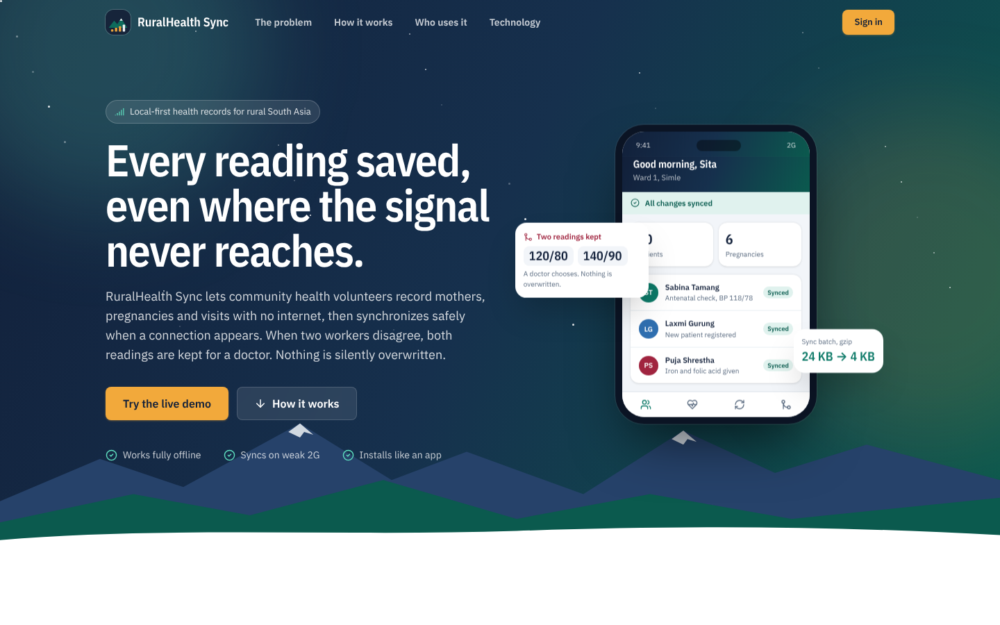
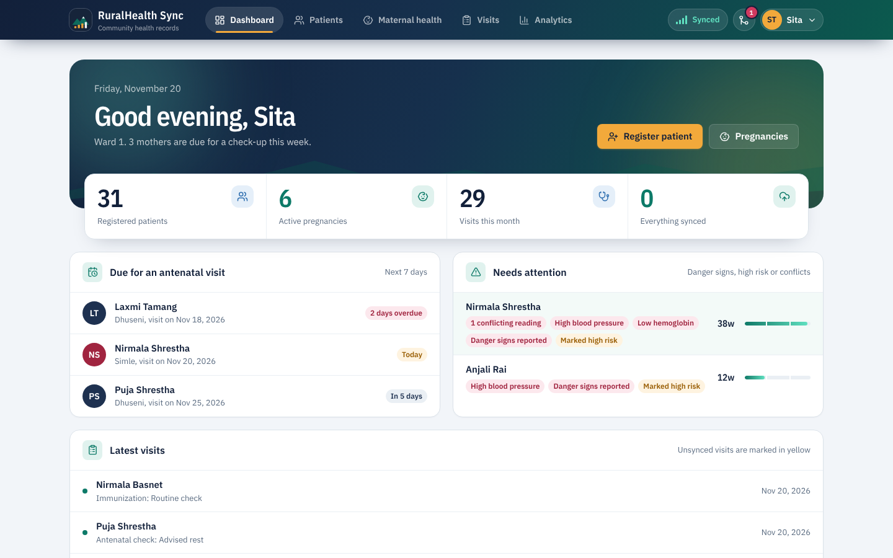
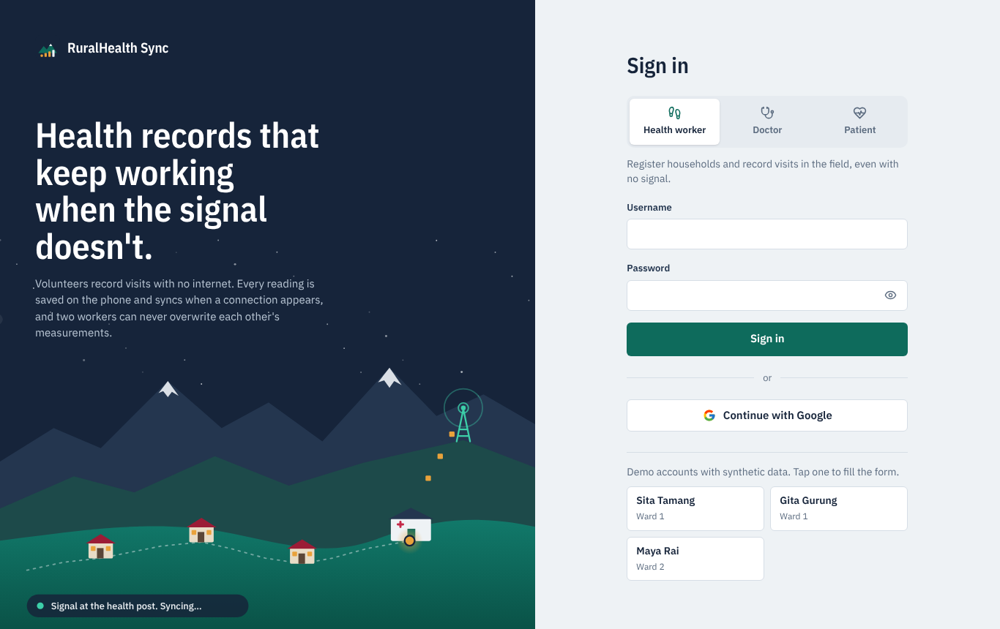
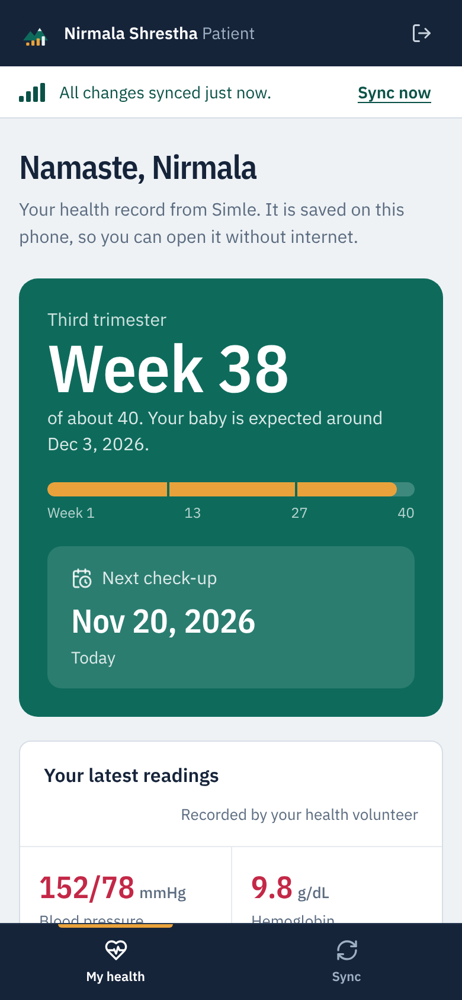

# Sewika (सेविका)

**Design and Implementation of a Local-First Distributed Big Data Platform for Rural Community Health Records under Intermittent Connectivity**

Female Community Health Volunteers in rural Nepal, Lady Health Workers in Pakistan and
rural clinic staff in Bangladesh and Sri Lanka often work with 2G/3G coverage that comes
and goes, or with no power for days. Cloud-only health record systems stop working when
the connection drops, and naive offline caching loses updates when two workers edit the
same household or pregnancy record.

Sewika is an installable web app (PWA) that keeps working with no internet,
saves every change on the phone first, and synchronizes safely later. When two workers
record different clinical values for the same patient while offline, **both values are
kept** and a doctor reviews them. Nothing is silently overwritten.



| Health worker dashboard | Animated sign-in | Patient view (phone) |
|---|---|---|
|  |  |  |

The public home page (`/home`) explains the project for visitors and examiners; signed-in
users get the app with a horizontal navigation bar. Full home page: [docs/screenshots/home-full.png](docs/screenshots/home-full.png).

---

## Contents

1. [What you need to install](#1-what-you-need-to-install)
2. [Run everything with Docker (recommended)](#2-run-everything-with-docker)
3. [Daily development without Docker for the app](#3-daily-development)
4. [Demo script for the presentation](#4-demo-script)
5. [Accounts](#5-demo-accounts)
6. [How the book chapters are used](#6-how-the-ddia-chapters-are-used)
7. [Tests and experiments](#7-tests-and-experiments)
8. [Put it online (shareable link)](#8-put-it-online)
9. [Google sign-in (optional)](#9-google-sign-in)
10. [Team split and Git workflow](#10-team-split-and-git-workflow)
11. [Project structure](#11-project-structure)
12. [Troubleshooting](#12-troubleshooting)

---

## 1. What you need to install

You do **not** install Kafka, Spark, PostgreSQL, MinIO, etcd, Prometheus or Grafana
separately. They all run inside Docker from one file.

| Software | Why | Download |
|---|---|---|
| **Docker Desktop** | Runs all big data services | docker.com → Docker Desktop for Windows (enable WSL 2 when asked) |
| **Node.js 22 LTS** | Runs the React app and Node API during development | nodejs.org |
| **Git** | Version control / GitHub | git-scm.com |
| VS Code | Editor | code.visualstudio.com |

**8 GB laptops:** give Docker about 5 GB. Create `C:\Users\<you>\.wslconfig` with:

```ini
[wsl2]
memory=5GB
processors=4
```

then run `wsl --shutdown` in PowerShell and restart Docker Desktop.

## 2. Run everything with Docker

```bash
git clone https://github.com/<your-team>/ruralhealth-sync.git
cd ruralhealth-sync/infrastructure

# Layer 1 — core distributed system (about 1 GB RAM)
docker compose up -d --build
```

Open **http://localhost:8088** and sign in with a demo account (section 5).
The first start takes a few minutes (images download, demo data is created).

| Layer | Command | Adds | Extra RAM |
|---|---|---|---|
| Core | `docker compose up -d --build` | PostgreSQL primary + replica, 3× etcd, 2× Node API, nginx load balancer, MinIO | ~1 GB |
| Big data | `docker compose --profile bigdata up -d` | Kafka, Spark master + worker, Spark streaming job | ~2.5 GB |
| Batch job | `docker compose run --rm spark-batch` | Runs the nightly Spark batch once | ~1 GB while running |
| Monitoring | `docker compose --profile monitoring up -d` | Prometheus, Grafana | ~300 MB |

| Web page | URL | Login |
|---|---|---|
| App | http://localhost:8088 | see section 5 |
| Spark master UI | http://localhost:8080 | – |
| MinIO console | http://localhost:9001 | minioadmin / minioadmin |
| Prometheus | http://localhost:9090 | – |
| Grafana | http://localhost:3000 | admin / admin (dashboard "Sewika — system") |

Stop everything: `docker compose --profile bigdata --profile monitoring down`.
Delete all data and start fresh: add `-v` to that command.

## 3. Daily development

Run only the database in Docker and the app on your machine (fast reloads):

```bash
cd infrastructure && docker compose up -d postgres-primary
cd ../backend  && cp .env.example .env && npm install && npm run dev     # API on http://localhost:4000
cd ../frontend && npm install && npm run dev                               # App on http://localhost:5173
```

The Vite dev server forwards `/api` to the backend. Kafka, etcd and MinIO are optional
in development: leave their variables empty in `backend/.env` and the API runs as a
single instance, keeps events in the outbox table and stores files on disk.

> The service worker (offline app shell) is only active in a production build.
> To test offline mode in development, run `npm run build` in `frontend/` and open
> http://localhost:4000 — the backend serves the built app.

## 4. Demo script

A 10-minute demonstration for the professor. Use two browser windows: a normal one
and an incognito/private one (each has its own local database, like two phones).

**A. Offline work and conflict-free sync**
1. Window 1: sign in as **Sita** (Health worker). Window 2: sign in as **Gita**.
2. In both, open the same pregnant woman from *Maternal health*.
3. In both, open *Sync status* → network simulator → **Offline**. The ribbon turns yellow.
4. Window 1: *Update pregnancy* → BP 118/78. Window 2: BP 152/98. Register a new patient in one window too.
5. Reload the page while offline: the app still opens (service worker) and the changes are still there (IndexedDB).
6. Switch Window 1 back to **Real network**, then Window 2. Both sync automatically.
7. Window 2 shows *Conflicts (2)*: both blood-pressure readings are kept with who, when and which phone.
8. Sign in as **Dr. Anita Sharma** (Doctor) → *Conflicts* → keep one reading, add a note → *Resolve*. All phones receive the decision on their next sync.
9. Admin → *Conflict handling mode* → **Naive overwrite**, repeat steps 3–6: one reading disappears with no trace. Switch back to **Safe merge**.

**B. Weak network**: *Sync status* → **2G** or **Flaky**, make edits, watch the ribbon and the sync history (gzip saves ~80% of bytes; retried requests are reported as duplicates and never applied twice).

**C. Distributed backend** (sign in as admin, keep the *Admin* page open — it refreshes every 5 s)
- `docker compose stop api-1` → the app keeps working through nginx; within ~5 s the Admin page shows `api-2` as the etcd leader.
- `docker compose stop etcd2` → leader election still works (2 of 3 Raft nodes).
- `docker compose stop postgres-primary` → after 3 failed health checks (~10 s) the leader promotes the replica; the PostgreSQL tile shows "Writes go to the replica", epoch 1. Create a patient: it works.
  (To reset afterwards: `docker compose down -v && docker compose up -d --build`.)

**D. Big data pipeline**
1. `docker compose --profile bigdata up -d` → Admin shows Kafka connected; outbox drains to 0 (events made while Kafka was down are not lost).
2. Make some changes in the app; after ~1 minute *Analytics → Live event stream* shows Spark Structured Streaming counts.
3. `docker compose run --rm spark-batch` → *Analytics* now says "Computed by the Spark batch job" and lists the job run.

**E. Patient**: sign in on a phone-sized window as **Demo mother** (Patient tab): read-only "My health" page with pregnancy week, next check-up, readings, visits and danger signs. Works offline after the first sync.

## 5. Demo accounts

All data is synthetic (no real people).

| Tab | Username | Password | Role |
|---|---|---|---|
| Health worker | `sita` | `fchv123` | Volunteer, Ward 1 |
| Health worker | `gita` | `fchv123` | Volunteer, Ward 1 (use with Sita for conflicts) |
| Health worker | `maya` | `fchv123` | Volunteer, Ward 2 (cannot see Ward 1) |
| Health worker | `kamala` | `fchv123` | Volunteer, Ward 3 |
| Doctor | `supervisor` | `super123` | Doctor / supervisor, all wards, resolves conflicts |
| Doctor | `admin` | `admin123` | Administrator: users, failover, backups, sync mode |
| Patient | `mother` | `patient123` | Read-only access to her own record |

Change `JWT_SECRET` and these passwords before any real use.

## 6. How the DDIA chapters are used

| Chapter | In this project |
|---|---|
| 3 Data models | JSON document records + relational users/devices/audit; schema-on-read in Spark |
| 4 Storage & retrieval | Append-only `sync_events` log and phone outbox; tombstones; indexes |
| 5 Encoding & evolution | Versioned events, server upcasts old app versions; gzip sync batches |
| 6 Replication | Every phone is a leader (multi-leader); version vectors; PostgreSQL WAL replica; failover |
| 7 Sharding | Records partitioned by ward in PostgreSQL; Kafka partitions keyed by ward; wards sync only their own data |
| 8 Transactions | Atomic local write + outbox entry; one ACID transaction per event with row locks; transactional outbox |
| 9 Distributed systems trouble | Unreliable networks (idempotent retries), unreliable clocks (hybrid logical clocks), fencing epochs |
| 10 Consistency & consensus | Strong eventual consistency; causality; etcd (Raft) leader election; Kafka KRaft |
| 11 Batch & streams | Kafka log; Spark Structured Streaming with de-duplication; nightly Spark batch with a MapReduce step |

Details: [docs/architecture.md](docs/architecture.md) · [docs/database-design.md](docs/database-design.md)

## 7. Tests and experiments

```bash
cd shared  && npm test     # 10 unit tests: clocks, version vectors, merge rules, schema evolution
cd backend && npm test     # 12 integration tests (start the API first): conflicts, LWW, idempotency,
                           # append-only visits, ward isolation, schema upcasting, patient access
pip install pyspark==3.5.7 && python analytics/tests/test_batch_logic.py   # Spark batch logic (needs Java 17)

node experiments/simulate-clients.js --clients 3,10,50                 # safe merge
node experiments/simulate-clients.js --clients 3,10,50 --mode naive    # baseline for comparison
```

The experiment simulates many phones going offline, editing the same pregnancies,
reconnecting at once and re-sending 10% of their requests. It reports sync time,
events per second, p95 latency, bytes before/after gzip, conflicts, **readings lost**,
duplicates detected and whether all phones converged. Results are saved as JSON in
`experiments/results/`. Run it on your own laptop and copy the numbers into
[docs/testing-results.md](docs/testing-results.md). The tests and experiments add
records to the database; reset with `docker compose down -v` before the final demo.

## 8. Put it online

The simplest shareable version is one web service plus a hosted PostgreSQL database.
The cloud version runs the same sync engine; Kafka/Spark/etcd/MinIO stay in the local
Docker demo (explain this as the deployment plan in the report).

1. Create a free PostgreSQL database (for example on **Neon**, neon.tech) and copy its connection string.
2. Push this repository to GitHub.
3. On **Render** (render.com): *New → Blueprint* → choose the repository. It reads `render.yaml`.
4. Paste the connection string into `DATABASE_URL` and deploy.
5. Open the `https://….onrender.com` link on a phone → browser menu → *Add to Home screen*.

Free plans can sleep when idle, so the first visit after a pause can take about a minute.
Uploaded documents are stored on the server's disk in this mode and may be lost on a
redeploy; set the `MINIO_*` variables to any S3-compatible storage to keep them.

PWAs (offline mode, install to home screen) require **HTTPS** or `localhost`.

## 9. Google sign-in

Username + password works everywhere, including offline. Google sign-in is optional:

1. Go to console.cloud.google.com → create a project.
2. *APIs & Services → OAuth consent screen* → External → fill app name and your email.
3. *Credentials → Create credentials → OAuth client ID → Web application*.
   Authorized JavaScript origins: `http://localhost:8088`, `http://localhost:4000`, `http://localhost:5173` and your Render URL.
4. Copy the **Client ID** and set `GOOGLE_CLIENT_ID` (in `backend/.env`, in a `.env` file next to `docker-compose.yml`, or in Render's environment settings). Restart the API.
5. Link people to their Google email: *Admin → Add user → Google email*, or for a demo user:
   ```bash
   docker compose exec postgres-primary psql -U ruralhealth -c "UPDATE users SET email='you@gmail.com' WHERE username='supervisor'"
   ```

The login page then shows Google's official button. Google only proves who the person
is; an administrator still decides who has an account and which role it has.

## 10. Team split and Git workflow

The code is split into folders so two people can work in parallel without touching each other's files:

| Member | Owns | Main files |
|---|---|---|
| Member 1 | Phone app: offline storage, sync engine (client), screens | `frontend/` |
| Member 2 | Server, distributed infrastructure, analytics | `backend/`, `infrastructure/`, `analytics/` |
| Member 3 | Experiments, results, report, slides, demo video | `experiments/`, `docs/` |
| Shared | Data model and merge rules — change only together | `shared/` |

```bash
git checkout -b feature/<what-you-are-doing>
# … work, commit …
git push -u origin feature/<what-you-are-doing>
# open a Pull Request on GitHub; the other member reviews and merges into main
```

Agree on any change to `shared/schema.js` first, because both the app and the server use it.

## 11. Project structure

```
ruralhealth-sync/
├── shared/                 data model, hybrid logical clock, version vectors, merge rules (+ tests)
├── frontend/               React + Vite PWA, Tailwind CSS
│   └── src/
│       ├── pages/          Home (public landing), Login, Dashboard, Patients, PatientDetail, MaternalHealth,
│       │                   VisitHistory, SyncStatus, Conflicts, Analytics, Admin, MyHealth (patient)
│       ├── components/     Layout, SignalRibbon, VillageScene (login animation), RecordForm, ConflictCard, ui
│       ├── offline/        indexedDB.js, repository.js, syncEngine.js, serviceWorker.js, networkSim.js, device.js
│       ├── context/        Auth (incl. offline sign-in), Sync, Toast
│       ├── hooks/          live IndexedDB queries
│       └── services/api.js
├── backend/                Node.js + Express
│   └── src/
│       ├── routes/  controllers/  middleware/ (auth, RBAC, metrics)
│       ├── services/       syncService, conflictService, analyticsService, adminService, storageService (MinIO)
│       ├── kafka/          producer, outboxPublisher (transactional outbox)
│       ├── coordination/   etcd leader election, DB leader pointer, automatic failover
│       ├── database/       pool (primary/replica), migrations, seed
│       └── server.js
├── analytics/              Spark Structured Streaming + nightly batch (+ test)
├── infrastructure/         docker-compose, PostgreSQL replication scripts, nginx, Prometheus/Grafana
├── experiments/            multi-client simulator
├── docs/                   architecture, database design, testing results template, screenshots
└── render.yaml             one-click cloud deployment
```

### Optional hero image

The home page is fully illustrated in code, so it needs no image files. To add a photo or
AI-generated picture behind the hero text, save it as `frontend/public/images/hero.jpg`
(about 1600×1000, under 400 KB) and rebuild. It is shown softly under the dark gradient.

## 12. Troubleshooting

| Problem | Fix |
|---|---|
| `port 5432 is already allocated` | Another PostgreSQL is running on your PC. Stop it, or change `"5432:5432"` to `"5434:5432"` in `docker-compose.yml` and use port 5434 in `backend/.env` |
| Replica keeps restarting with `\r: command not found` | Git converted line endings. Run `git config --global core.autocrlf input`, delete and re-clone the repository |
| Docker is very slow / containers killed | Start fewer layers; set the `.wslconfig` memory limit (section 1) |
| Spark job downloads packages every time | It caches them in the `spark-ivy` volume after the first run; the first run needs internet |
| App does not work offline | Offline mode needs a production build over `https://` or `localhost`, and one online visit first |
| "Session expired" | Sign in again; changes made offline are kept and sync afterwards |
