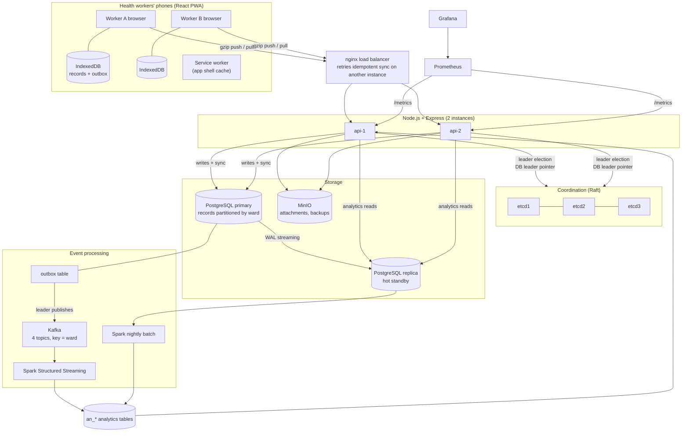

# Architecture

## Overview



## The sync protocol

```mermaid
sequenceDiagram
  participant P as Phone (offline)
  participant DB as IndexedDB
  participant S as API server
  participant PG as PostgreSQL

  P->>DB: save record + append event to outbox (one transaction)
  Note over P,DB: works with no signal; event carries eventId,<br/>dot {device, counter}, HLC timestamp, seen version vector
  P-->>S: (signal returns) POST /api/sync/push [≤25 events, gzip]
  loop each event, own DB transaction
    S->>PG: INSERT sync_events (event_id UNIQUE) — duplicate? stop
    S->>PG: SELECT record FOR UPDATE
    S->>S: per field: causal → apply; concurrent clinical → conflict;<br/>concurrent other → last-writer-wins (HLC)
    S->>PG: UPDATE record (new server_seq) + INSERT outbox
  end
  S-->>P: results per event + server HLC
  P->>DB: mark acknowledged events SYNCED
  P->>S: POST /api/sync/pull {since: lastSeq}
  S-->>P: changed records (own wards only) + their conflicts
  P->>DB: store; re-apply still-pending local edits on top
```

## How each chapter of *Designing Data-Intensive Applications* is used

| Chapter | Concept | Where in the code |
|---|---|---|
| 3 Data models | Document model (JSONB records) + relational tables (users, devices, audit); schema-on-read in Spark | `backend/src/database/migrations/001_init.sql`, `shared/schema.js`, `analytics/batch/nightly_batch.py` |
| 4 Storage & retrieval | Append-only event log (`sync_events`), local outbox log, indexes, tombstones for deletes | `001_init.sql`, `frontend/src/offline/indexedDB.js` |
| 5 Encoding & evolution | Versioned events; old app versions upcast on the server (backward compatibility); gzip encoding of sync batches | `shared/schema.js → upcastEvent`, `frontend/src/services/api.js` |
| 6 Replication | Multi-leader (every phone accepts writes offline); version vectors detect concurrent writes; leader–follower PostgreSQL with WAL streaming; read-after-write by reading sync data from the leader; failover | `shared/versionVector.js`, `backend/src/database/pool.js`, `backend/src/coordination/failover.js` |
| 7 Sharding | Records partitioned by ward (`PARTITION BY LIST`); Kafka partitions keyed by ward; devices sync only their ward | `001_init.sql`, `backend/src/kafka/producer.js`, `syncService.pullChanges` |
| 8 Transactions | Atomic local write (record + outbox) in IndexedDB; one ACID transaction per event on the server with row locks; transactional outbox | `frontend/src/offline/repository.js`, `backend/src/services/syncService.js` |
| 9 Trouble with distributed systems | Unreliable networks (retries, idempotency, timeouts before failover), unreliable clocks (hybrid logical clocks), fencing epochs for the DB leader | `shared/hlc.js`, `backend/src/coordination/*` |
| 10 Consistency & consensus | Strong eventual consistency (all replicas converge); causality via version vectors; etcd/Raft for leader election; KRaft in Kafka | `shared/merge.js`, `backend/src/coordination/coordinator.js` |
| 11 Batch & stream processing | Kafka as a durable log; Spark Structured Streaming with watermark + de-duplication; nightly Spark batch with an explicit MapReduce step | `analytics/` |

## Merge rules

| Situation | Example | Result |
|---|---|---|
| The writer had seen the current value | Sita edits BP after pulling Gita's reading | Applied |
| Concurrent, same value | Both record Hb 11.2 | No conflict |
| Concurrent, non-clinical field | Two different phone numbers | Last writer wins by hybrid logical clock (deterministic on every replica) |
| Concurrent, clinical field | BP 120/80 vs 140/90 | **Both kept**, conflict opened, supervisor decides |
| Visit edits | Any | Rejected: visits are append-only; record a correcting visit |
| Retried request | Same eventId twice | Second one reported as duplicate, never applied twice |

## Failure handling

| Failure | What happens |
|---|---|
| Phone has no signal for days | Everything is stored in IndexedDB; the outbox grows; sync resumes automatically |
| Browser closed / phone restarted | IndexedDB is persistent (persistent-storage permission requested) |
| Connection drops mid-push | Events not acknowledged stay pending; retry is safe (idempotency) |
| One API instance dies | nginx sends traffic to the other; etcd lease expires and the other becomes leader within ~5 s |
| PostgreSQL primary dies | The leader detects 3 failed checks, promotes the replica (`pg_promote`), writes a new epoch to etcd; all instances switch |
| Kafka broker down | Events wait in the outbox table; nothing lost; published when Kafka returns |
| Duplicate Kafka delivery | Spark drops duplicates by eventId within the watermark |
